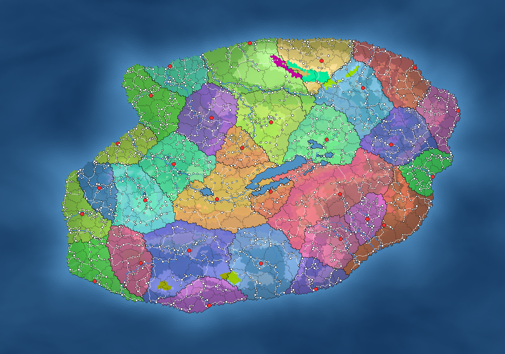
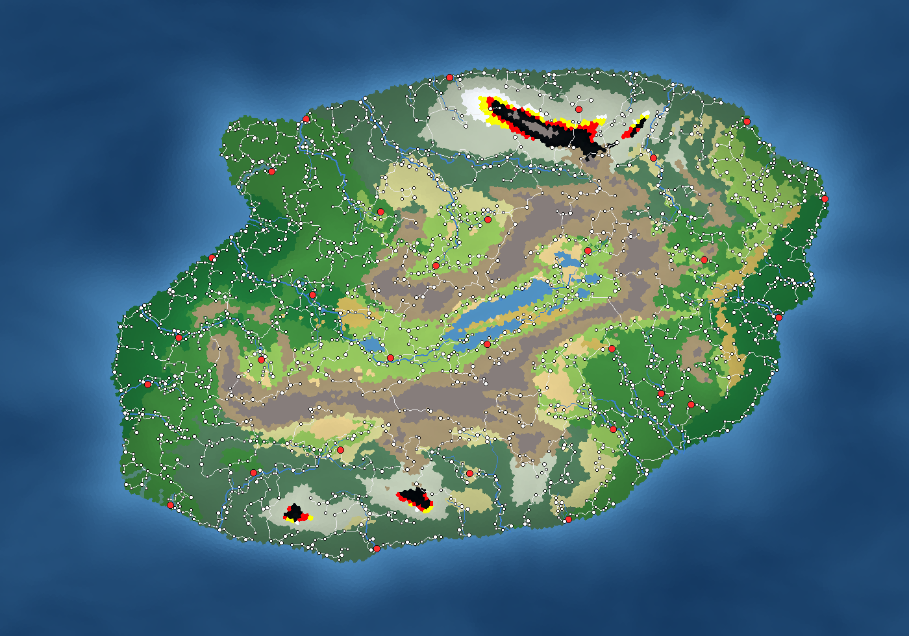

# Giai đoạn 1 – World Generator: báo cáo triển khai

Lõi sinh thế giới nằm ở `src/Vigo.Core/Generation`. Chạy thử:

```bash
dotnet build src/Vigo.Cli -c Release
dotnet src/Vigo.Cli/bin/Release/net8.0/Vigo.Cli.dll --seed 12345 --out out      # sinh + xuất 3 bản đồ PNG
dotnet src/Vigo.Cli/bin/Release/net8.0/Vigo.Cli.dll --cells 40000 --diag 300    # quét 300 seed, thống kê lỗi
dotnet run -c Release --project src/Vigo.Tests -- --seeds 100                   # bộ test
```

> Nếu máy không có NuGet, thêm `nuget.config` với `<clear />` trong `packageSources` để build offline (dự án không dùng gói ngoài).

## Kết quả đo được

| Hạng mục | Kết quả |
|---|---|
| Thế giới mặc định (40k ô, 30 quốc gia) | ~0,5–1 s |
| 300k ô, 30 quốc gia (mục tiêu TDD: < 30 s) | ~5 s, hợp lệ ngay lần đầu |
| Quét 100 seed (20k ô) với tối đa 4 lần thử | 100/100 hợp lệ; 99 ngay lần đầu |
| Quét 300 seed (40k ô), **chỉ 1 lần thử** | 298/300 hợp lệ (2 seed còn lại được thử lại tự động) |
| Tất định | cùng seed → cùng hash; khác seed → khác hash |
| Test | 12/12 đạt |

Ví dụ (seed 12345): 30 quốc gia, ~460 tỉnh (8–20/nước), ~1.900 thành phố (2–8/tỉnh), ~2.400 đoạn đường, 250 mỏ.

| Chính trị | Địa hình | Tài nguyên |
|---|---|---|
|  |  |  |

## Những gì đã được kiểm chứng bằng test (không phải dữ liệu giả)
- Đồ thị ô bất quy tắc (bậc kề khác nhau, không phải lưới 4/8), liên thông, đối xứng.
- Phân cấp Quốc gia → Tỉnh → Thành phố nhất quán hai chiều; mỗi nước đúng 1 thủ đô nằm trong lãnh thổ; mọi tỉnh liên thông.
- Địa lý có logic: thành phố tập trung gần nước (≈45% so với ≈20% của đất nói chung); cảng luôn giáp biển; đường nối trong một nước, cầu đặt ở ô sông.
- Tài nguyên phân bố không đều (Gini ≈ 0,8) và có quốc gia thiếu hẳn một số loại.
- Cấu hình chỉnh được (số quốc gia, số tỉnh, tỉ lệ đất…).

## Hạn chế đã biết (chưa che giấu)
1. **Chưa có xói mòn** địa hình (TDD bước 3); sông/thung lũng còn đơn giản.
2. **Hồ không thuộc quốc gia nào** ở GĐ 1 (lãnh hải/hồ sẽ xử lý cùng quyền kiểm soát nước sau). Vài ô đất bị hồ chia cắt có thể chưa có chủ.
3. **Hình dạng quốc gia**: có vài nước nhỏ/dải mỏng dù hợp lệ về số ô và lương thực; cần luật hình dạng (độ gọn) nếu muốn đẹp hơn.
4. **Khí hậu đơn giản**: đã có bóng mưa, vĩ độ, độ cao; chưa có gió/dòng hải lưu thật; sa mạc và vùng lạnh còn ít.
5. **Mỏ ngoài khơi** chưa thuộc quốc gia nào (cần khái niệm vùng đặc quyền kinh tế).
6. **Đường chỉ nối trong từng nước**; đường quốc tế, đường sắt, cảng/sân bay chi tiết thuộc GĐ sau.
7. **Dân số/GDP** mới là giá trị khởi tạo từ độ phì nhiêu, chưa do mô phỏng kinh tế (GĐ 3) tạo ra. Các trường ngân sách, quân đội, công nghệ của quốc gia **chưa được tạo** để không có dữ liệu giả.
8. **Tính tất định giữa các nền tảng** (PC ↔ Android) dùng `Math.Exp/Log/Cos/Sqrt` của .NET; cần test chéo nền tảng khi có bản Android.
9. **Chưa có lớp Presentation** (camera 3 cấp, bản đồ tương tác trong Unity); ảnh PNG chỉ là công cụ kiểm tra.
