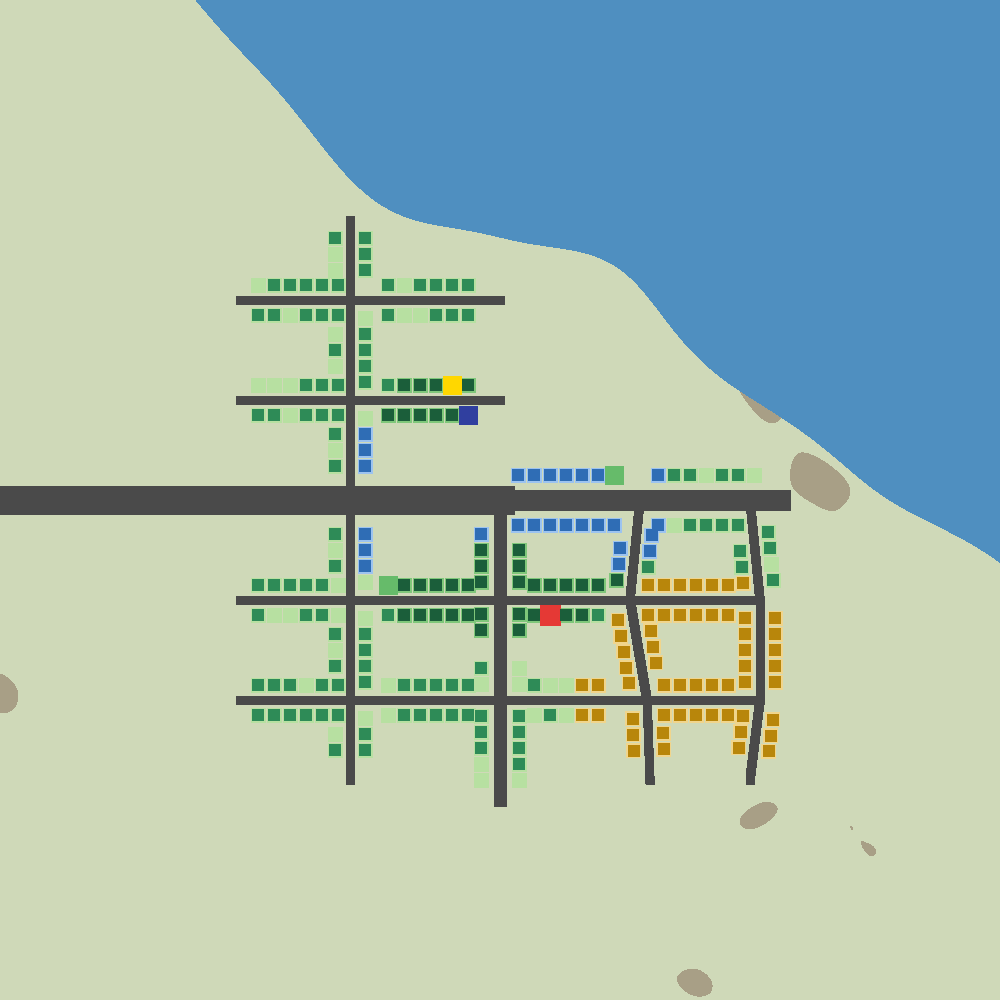
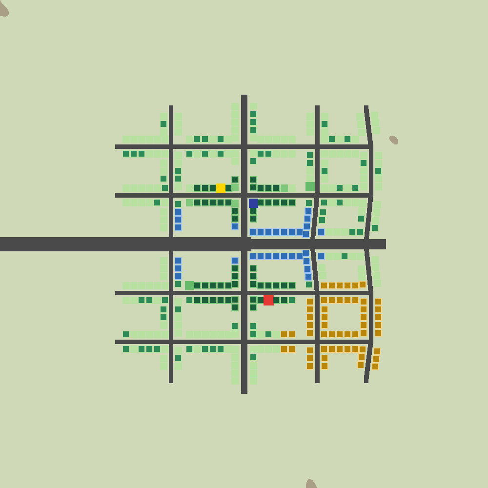

# Giai đoạn 2 – City Builder: báo cáo triển khai (lõi mô phỏng)

Mã nguồn: `src/Vigo.Core/City` (namespace `Vigo.Core.CityBuilder`). Chạy thử:

```bash
dotnet run -c Release --project src/Vigo.Tests                                   # 23 test (world + city)
dotnet src/Vigo.Cli/bin/Release/net8.0/Vigo.Cli.dll --city capital --seed 31 --out out   # sim 4 năm + ảnh
dotnet src/Vigo.Cli/bin/Release/net8.0/Vigo.Cli.dll --city port --seed 31 --out out      # thành phố cảng
```

## Đã làm (đều có test)
- **Đồ thị đường**: nút/cạnh; 4 loại (hẻm, đô thị, đại lộ, cao tốc). Đường mới tự **tách nút khi giao nhau**, tự nối vào nút/đoạn đường có sẵn (snap), chia đoạn ≤ 250 m.
- **Địa hình lấy từ thế giới** (`WorldTerrain`): độ dốc ô thế giới → độ gồ ghề; thành phố ở ô sông có sông chảy đúng hướng `FlowTo`; thành phố cảng có biển phía đại dương; ô kề hồ có hồ. Thành phố nội địa không có nước (test kiểm tra).
- **Lệnh có kiểm tra hợp lệ**, trả về lỗi rõ ràng: ngoài bản đồ, đoạn quá ngắn, đầu đường trên nước, địa hình quá dốc, đường thường qua nước (chỉ đại lộ/cao tốc được bắc cầu, nhịp ≤ 80 m), đường đè lên công trình đã xây.
- **Lô đất** sinh dọc hai bên đường (cao tốc không có mặt tiền), loại bỏ lô đè lên đường cắt hoặc nằm trên nước/dốc.
- **Phân khu**: nhà ở thấp tầng, nhà ở cao tầng, thương mại, công nghiệp. **Dịch vụ**: trường, bệnh viện, công an, công viên. **Phá bỏ**.
- **Kết nối quốc lộ**: công trình chỉ phát triển nếu mạng đường nối được tới nút thoát (điểm vào của quốc lộ; tự chọn điểm khô trên mép bản đồ).
- **Mô phỏng hằng tuần**: nhu cầu R/C/I → xây dựng (thành phố lan dần từ lõi) → nâng cấp → di cư vào/ra → việc làm → chỉ số.
- **Phủ dịch vụ theo quãng đường đi trên mạng đường** (không phải đường chim bay), có **sức chứa**: một trường phục vụ 400 cư dân; quá tải thì độ phủ giảm, nhiều cơ sở cùng phủ một khu thì cộng dồn.
- **Ô nhiễm** từ công nghiệp theo khoảng cách; **quãng đường đi làm** đo trên mạng đường.
- **Chất lượng sống (QoL)** theo TDD 7.5, tính theo từng khu nhà ở rồi lấy trung bình theo dân cư, kèm **nhóm 20% thấp nhất** để thấy bất bình đẳng.
- **Tất định**: cùng seed + cùng lệnh → cùng trạng thái; khác seed → khác.

## Kết quả mô phỏng mẫu (kịch bản demo, 4 năm)
| Cảng (Taolinn) | Thủ đô (Kimethaa) |
|---|---|
|  |  |

Dân ≈ 2.000, nhà ở ≈ 2.200–2.400, việc làm ≈ 780. Hành vi mô phỏng có phản hồi hợp lý: người chơi chỉ phân khu ít công nghiệp/thương mại → thất nghiệp tăng đến ~35% → QoL tụt xuống ~0,39 → dân ngừng tăng (cân bằng tự nhiên, không bùng nổ vô hạn). Có dịch vụ: QoL 0,40 so với 0,30 khi không có (test).

## Hạn chế đã biết
1. **Chưa có Unity/3D**: ảnh PNG 2D chỉ để kiểm tra; camera 3 cấp, mô hình công trình, hoạt hình thuộc lớp Presentation.
2. **Phạm vi nội dung còn nhỏ so với GDD**: mới 4 loại phân khu và 4 loại dịch vụ; chưa có siêu thị, khách sạn, đại học, sân vận động, tòa thị chính, hạ tầng quân sự, biệt thự/chung cư…; công trình chưa có "biến thể kiến trúc" (GDD I.3) — hiện chỉ có `Kind` + `Level`.
3. **Giao thông**: đường thẳng từng đoạn (chưa có đường cong/spline, hầm, đường sắt, nhà ga, cảng, sân bay); quãng đường tính theo tốc độ tự do, **chưa có phân bổ lưu lượng/ùn tắc** (TDD 7.3).
4. **QoL mới gồm 7 thành phần đã mô phỏng** (việc làm, y tế, giáo dục, an ninh, đi lại, môi trường, giải trí). Chưa có lương thực/nước, thu nhập, giá nhà, hòa bình — sẽ thêm khi kinh tế (GĐ 3) và chiến tranh (GĐ 7) hoạt động.
5. **Chưa có kinh tế**: xây dựng miễn phí, không thuế/ngân sách/chi phí vận hành (GĐ 3). Hằng số mô hình (tỉ lệ lao động 60%, sức chứa dịch vụ, bán kính phủ…) là **giá trị khởi đầu chưa cân bằng**.
6. **Địa hình cục bộ là thủ tục** (noise tất định) dựng từ dữ liệu ô thế giới, chưa phải heightmap thật; hình dạng sông/biển/hồ chỉ mang tính xấp xỉ.
7. **Hiệu năng chưa đo ở quy mô lớn** (TDD mục 7.4: ~20.000 công trình). Một số chỗ còn thuật toán O(n²) (chọn lô đất, tính phủ dịch vụ); cần chỉ mục không gian trước khi mở rộng. **Chưa có LOD mô phỏng L0/L1** (TDD 5.2) nên chưa thể mô phỏng thành phố của AI ở mức tổng hợp.
8. Đường mới **snap** vào nút trong 25 m nên đôi khi lệch nhẹ so với điểm người chơi chọn.
